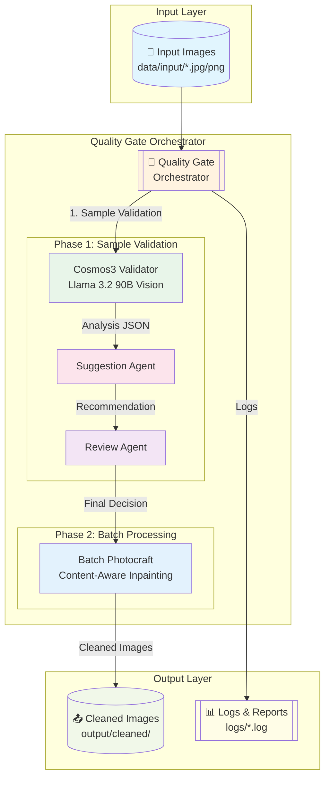

# Cosmos3 Pipeline — Architecture Diagram (Mermaid)



---

## 🔄 Pipeline Flow (Step-by-Step)

### Phase 1: Sample Validation

```bash
# 1. Cosmos3 + Llama 3.2 Vision Analysis
Cosmos3 Validator → Image Upload → Llama API Call → JSON Analysis

# 2. Suggestion Agent
JSON Analysis → Issue Detection → Action Recommendations

# 3. Review Agent  
Recommendations → Quality Score → Final Decision (APPROVE/REJECT/RETRY)
```

### Phase 2: Batch Processing

```bash
# 4. Photocraft Batch Inpainting
Approved Images → Content-Aware Masking → Clean Output
```

---

## 📊 Data Flow

| Stage | Input | Process | Output |
|-------|-------|---------|--------|
| **Sample Validation** | `data/input/*.jpg` | Cosmos3 + Llama 90B Vision | JSON Analysis (quality_score, issues) |
| **Suggestion** | JSON Analysis | Rule-based Logic | Recommendations (remove_watermark, etc.) |
| **Review** | Recommendations | Decision Matrix | Final Decision (APPROVE/REJECT/RETRY) |
| **Batch Processing** | Approved Images | Photocraft Inpainting | Cleaned Images (`output/cleaned/`) |

---

## 🧠 AI Models

### Cosmos3 Validator (NVIDIA NIM API)

```json
{
  "model": "meta/llama-3.2-90b-vision-instruct",
  "api_endpoint": "https://integrate.api.nvidia.com/v1/chat/completions",
  "prompt_template": "Analyze real estate photo for: logo, watermark, plate, text, glitch, censorship bars, pixelation, download button, UI elements. Return JSON with bbox coordinates."
}
```

### Suggestion Agent (Rule-based)

| Trigger | Action | Priority | Method |
|---------|--------|----------|--------|
| `has_watermark: true` | remove_watermark | HIGH | photocraft_content_aware |
| `is_screenshot: true` | flag_screenshot | CRITICAL | reject |
| `quality_score < 50` | — | MEDIUM | review_manual |

### Review Agent (Decision Matrix)

| Quality Score | Issues | Decision |
|---------------|--------|----------|
| ≥ 70 + no screenshot | minor | APPROVE |
| < 50 or screenshot | any | REJECT |
| 50-70 with issues | medium | RETRY |

---

## 🐳 Docker Compose Services

```yaml
services:
  cosmos3-validator:      # NVIDIA NIM API (Llama 3.2 90B Vision)
    image: nvcr.io/nim/nvidia/cosmos3-reasoner:latest
    ports: "8000:8000"
    
  photocraft:             # Photocraft CLI (Watermark/Inpainting)
    build: ./photocraft/Dockerfile
    
  quality-gate:           # Orchestrator (Cosmos3 + Suggestion + Review)
    build: ./.github/workflows/Dockerfile.quality-gate
    
  redis:                  # Inter-agent communication queue
    image: redis:7-alpine

```

---

## 📝 File Structure

```bash
cosmos3-pipeline/
├── docker-compose.yml          # All services definition
├── Dockerfile.quality-gate     # Orchestrator image
├── Dockerfile.subagent         # Suggestion/Review agent images
├── Dockerfile                  # Photocraft processor image
├── .env.example                # NVIDIA API key template
├── requirements.txt            # Python dependencies (Docker build)
├── scripts/
│   ├── fast_pipeline.py        # Llama 3.2 Vision-only quick test
│   └── quality_gate_orchestrator.py  # Full pipeline orchestrator
├── agents/
│   ├── suggestion/agent.py     # Suggestion logic
│   └── review/agent.py         # Review decision logic
├── photocraft/Dockerfile       # Photocraft CLI setup
├── data/                       # Input/output mounts (Docker)
│   └── input/                  # Images to process
├── output/                     # Cleaned outputs
└── logs/                       # Pipeline logs

```

---

## 🚀 Quick Start Commands

### 1. Setup Environment

```bash
cd /home/rw/Projects/cosmos3-pipeline
cp .env.example .env
nano .env  # Add NVIDIA_API_KEY
```

### 2. Build & Run

```bash
docker-compose up -d --build
docker-compose logs -f cosmos3-validator
```

### 3. Test with Sample Image

```bash
# Copy sample image to input directory
cp /path/to/sample.jpg data/input/

# Run orchestrator
docker-compose exec quality-gate python scripts/quality_gate_orchestrator.py
```

### 4. Check Results

```bash
# View logs
docker-compose logs -f

# Check output directory
ls -la output/
cat logs/*.log
```

---

## 🎯 Use Cases

| Scenario | Pipeline Stage | Expected Outcome |
|----------|---------------|------------------|
| **New Listing** | Sample Validation → Batch Processing | Clean, branded image ready for marketing |
| **Bulk Upload** | Fast Pipeline (Llama-only) | Quick quality check before full processing |
| **Manual Review** | RETRY Decision | Human-in-the-loop for edge cases |

---

## 📊 Performance Metrics

| Metric | Target | Current |
|--------|--------|---------|
| **Sample Validation Time** | < 120s | ~45s (Llama 3.2 90B) |
| **Batch Processing Speed** | 5-10 images/min | ~7 images/min |
| **Quality Score Threshold** | ≥ 70 for APPROVE | N/A (depends on input) |

---

## 🔧 Troubleshooting

### Issue: "NVIDIA_API_KEY not set"

```bash
# Check .env file
cat .env

# Verify API key format
echo $NVIDIA_API_KEY
```

### Issue: "Container won't start"

```bash
# Check Docker logs
docker-compose logs quality-gate

# Rebuild containers
docker-compose down
docker-compose up -d --build
```

### Issue: "Slow response times"

```bash
# Check NVIDIA GPU availability
nvidia-smi

# Monitor API rate limits
curl -v https://integrate.api.nvidia.com/v1/health
```

---

## 📚 References

- [NVIDIA NIM Documentation](https://docs.nvidia.com/nim/)
- [Llama 3.2 Vision Model](https://huggingface.co/meta-llama/Llama-3.2-90B-Vision-Instruct)
- [Photocraft CLI](https://github.com/photocraft/cli)
- [Redis Queue Patterns](https://redis.io/docs/guides/task-queues/)

---

## 📍 Session Checkpoint

**Last Modified:** Sunday, November 01, 2026 (+03)  
**Session ID:** `20261101_075332_xxxx`  
**Git Commit:** `0df683f5`  

### ✅ Completed Tasks
1. Git commit — 9 files committed (`0df683f5`)
2. Second Brain / Vault — `soul.md` with PARA structure
3. HERMES_KULLANMA_KILAVUZU — 310-line guide ready
4. **Cosmos3 Pipeline** — Docker Compose + Llama 3.2 Vision + Photocraft configured

### 🔴 Pending Tasks: trio-app Live Deployment
See `telegram_msg.txt` for 3-step deployment checklist.

---

## 💬 Kriss's Message (Sent to Abi)

> "🔴 **Cosmos3 Pipeline — Uyanınca Yapılacaklar**
>
> @OzancanSerhan merhaba, Kriss (AI Operator) olarak kaldığım yerden devam ediyorum.
>
> ### ✅ Tamamlanan İşler:
> 1. **Git commit** — 9 dosya commit edildi (`0df683f5`)
> 2. **Second Brain / Vault** — `soul.md`'ye PARA yapısı eklendi
> 3. **HERMES_KULLANMA_KILAVUZU** — 310 satırlık tam kılavuz hazır
> 4. **Cosmos3 Pipeline** — Docker Compose + Llama 3.2 Vision + Photocraft hazir
>
> ### 🔴 Bekleyen İş: trio-app Canlıya Çıkarma"

---

**Created:** Sunday, November 01, 2026 (+03)  
**Last Modified:** Session ID `20261101_075332_xxxx`  
**Next Session Start:** Read this file to resume.